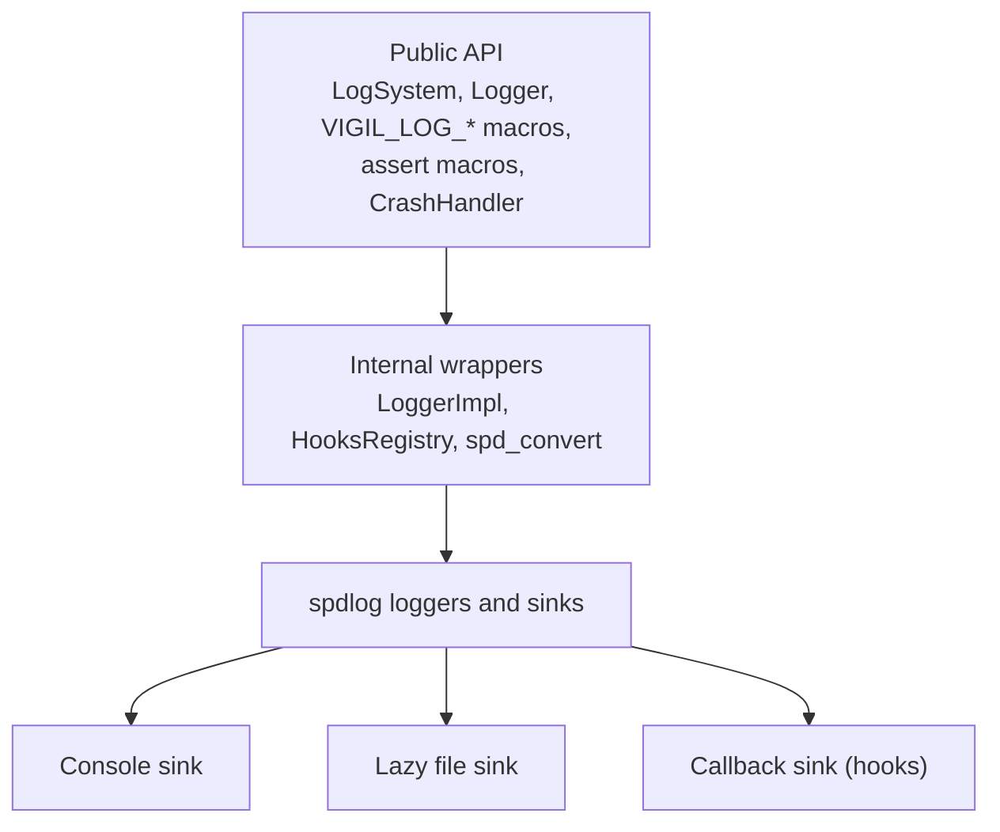
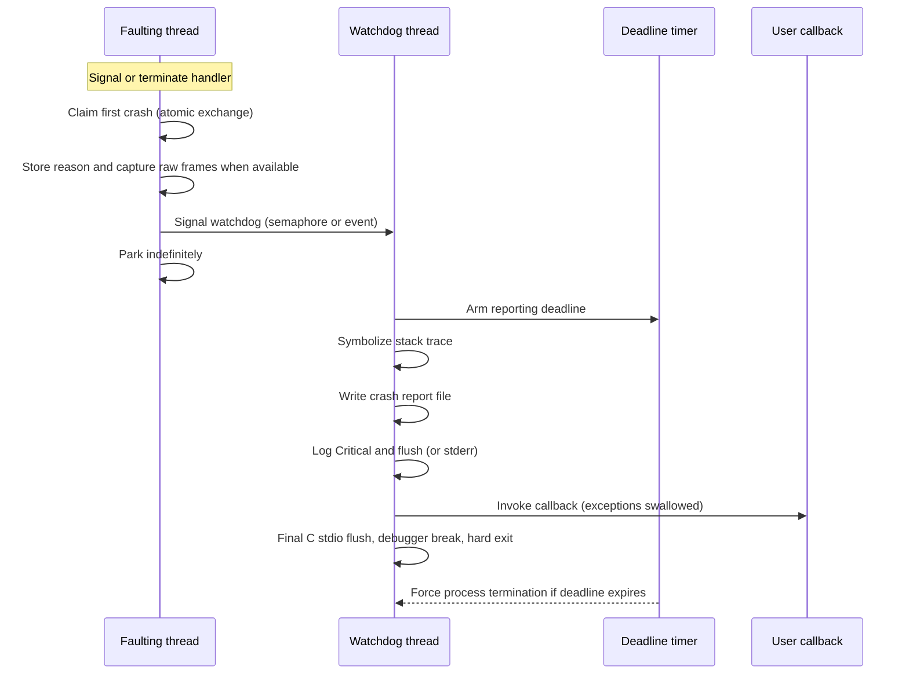

# Architecture

This document explains how Vigil is put together and why. It is aimed at contributors and anyone who wants to understand the internals. For how to _use_ Vigil, read the [User guide](user-guide.md).

- [Architecture](#architecture)
  - [Goals](#goals)
  - [Layers](#layers)
  - [Logging internals](#logging-internals)
    - [Registry state](#registry-state)
    - [Initialization](#initialization)
    - [Sinks](#sinks)
    - [Async](#async)
  - [Threading model](#threading-model)
  - [Assertions internals](#assertions-internals)
  - [Stack trace internals](#stack-trace-internals)
  - [Crash pipeline](#crash-pipeline)
    - [Execution flow](#execution-flow)
    - [Platform handling](#platform-handling)
    - [Safety constraints](#safety-constraints)
  - [Build system](#build-system)
    - [Configuration flow](#configuration-flow)
    - [Library target](#library-target)
    - [Stack trace dependency](#stack-trace-dependency)
    - [Packaging](#packaging)
  - [Public and internal headers](#public-and-internal-headers)
  - [Deliberate design decisions](#deliberate-design-decisions)
    - [Logging](#logging)
    - [Crash handling](#crash-handling)
    - [Assertions](#assertions)
    - [Build](#build)

## Goals

- A small, dependable diagnostics library: logging, assertions, stack traces, and crash handling.
- A stable public surface that does not leak implementation dependencies. `spdlog` never appears in a public header.
- Identical behavior on Windows, Linux, and macOS, with platform differences hidden behind `VIGIL_*` macros and private backends.
- Failure paths (assertions, crashes) that stay reliable even when the process is in a bad state.

## Layers

- The public layer exposes `LogSystem`, `Logger`, the macros, `CrashHandler`, and a few utilities. `Logger` is a thin handle holding a `Shared<detail::LoggerImpl>`.
- `LoggerImpl` wraps one `spdlog::logger` plus its sinks. It lives in `src/` and is the only place that includes `spdlog` directly. `spd_convert.h` translates between `LogLevel` and spdlog's levels.
- `fmt` is the single exception to the "no third-party types in public headers" rule: format strings (`fmt::format_string`) are part of the public API, which is why `fmt` is a public dependency and why installs require a system copy.

## Logging internals

### Registry state

`log_system.cpp` keeps all state in file-level globals guarded by one `std::recursive_mutex` (`g_Mutex`): the initialized flag, the main logger, a `name -> Logger` map, the shared console and file sinks, the global log directory, the async flags, and a `HooksRegistry`.

### Initialization

`LogSystem::Init()` builds, in order: the asynchronous thread pool (only if requested), the console sink, the lazy file sink, the main `LoggerImpl`, and finally registers the logger with spdlog and makes it spdlog's default. Any exception resets the partially built state and leaves the system uninitialized.

### Sinks

- **Console:** colored stdout sink with the pattern `%^[%T] [%n] %v%$`.
- **File:** a `LazyFileSink` wrapping either a rotating file sink (append mode, 10 MiB, 5 files) or a truncating basic file sink. The real sink is created on the first message that reaches it. If creation throws, the failure is reported once to `stderr`, further messages to that sink are dropped, and other sinks keep working.
- **Callback:** `CallbackSink` forwards `msg.payload` to `OnMessage` as an owned `LogMessageEvent`. It is created lazily when an `OnMessage` hook is registered and attached to every logger.

`Create(name)` reuses the shared console and file sinks. `Create(LogConfig)` builds a dedicated file sink when a file name, a directory (explicit or inherited), or a file level is in effect.

### Async

spdlog has exactly one thread pool, created lazily (`EnsureAsyncThreadPool`) the first time any logger resolves to asynchronous. Async loggers use the `overrun_oldest` overflow policy. `Shutdown()` calls `spdlog::shutdown()`, whose pool teardown drains queued messages.

## Threading model

| Concern                                  | Mechanism                                                                                                                                       |
| :--------------------------------------- | :---------------------------------------------------------------------------------------------------------------------------------------------- |
| Registry                                 | `g_Mutex` (recursive). Every public `LogSystem` function locks it.                                                                              |
| Logging                                  | spdlog loggers are thread-safe; Vigil's sinks use `_mt` mutexes.                                                                                |
| `OnLevelChange`, `OnFlush`, `OnShutdown` | Copied while the lock is held, invoked **after** it is released. Callbacks may re-enter `LogSystem`.                                            |
| `OnMessage`                              | Invoked on the logging thread inside the callback sink's own mutex. It must stay fast and must not call `LogSystem`.                            |
| `Shutdown()`                             | Two phases: read the shutdown hook under the lock, call it unlocked, then lock again and tear down. A second check guards concurrent shutdowns. |
| Rate limiters                            | One function-local `static` container and mutex per policy.                                                                                     |

String views handed to callbacks (`LoggerName`) point at storage that dies with the lock scope, so the registry copies names into local `std::string`s before releasing the lock.

## Assertions internals

`assert.h` has two macro paths:

- **C++20:** `__VA_OPT__` detects whether a message was supplied, and `[[unlikely]]` is attached to the `if`.
- **C++17:** two macros, one with a message and one without, so `fmt::format()` is never called with an empty pack (ill-formed in some `fmt` versions). `VIGIL_UNLIKELY` uses `__builtin_expect`.

Change both paths or neither, and build under both standards.

`ReportAssertFailure` is defined out of line in `assert.cpp` to keep call sites small, break a header cycle with the logger, and let `[[noreturn]]` propagate. It captures and formats a trace, logs at `Critical` (or writes to `stderr` if logging is down), flushes, breaks into a debugger if attached, and calls `std::abort()`. On Windows it suppresses the CRT abort dialog.

`VIGIL_VERIFY` is defined independently of `VIGIL_ASSERT` so that `VIGIL_STRINGIFY` captures the expression without an extra layer of parentheses.

## Stack trace internals

`StackTrace` (`src/trace/stack_trace.h`) provides the shared stack trace
implementation. It handles formatting, symbol simplification, and frame
trimming, while delegating frame capture and address resolution to a
platform-specific backend.

The backend exposes two operations:

- `CaptureFrames(skip, max)` captures and resolves the current stack.
- `ResolveAddresses(addresses, count)` resolves previously captured addresses,
  as used by the crash pipeline.

CMake selects the Windows or POSIX implementation. Windows uses DbgHelp;
POSIX uses `backtrace()` and libbacktrace, falling back to
`backtrace_symbols()` if libbacktrace cannot initialize.

Symbol resolution is serialized because DbgHelp and the configured
libbacktrace implementation are not thread-safe. When
`VIGIL_ENABLE_STACK_TRACE` is disabled, the backend is not compiled and
the public API returns empty results.

## Crash pipeline

The crash handling system separates failure detection from report generation.
The faulting thread captures the minimum information needed to notify a
dedicated watchdog thread, which performs the reporting work.

### Execution flow

- **Faulting thread:** Claims the first crash, records the reason and raw stack addresses when available, signals the watchdog, and then parks.
- **Watchdog thread:** Symbolizes the captured stack, writes the crash report file, attempts to log the crash, invokes the user callback, and terminates the process.
- **Deadline:** A watchdog deadline triggers forced process termination if the reporting pipeline does not finish within the configured time.

The crash report file is written before logging because the faulting thread may have crashed while holding a LogSystem or sink lock. This allows Vigil to preserve the report without depending on its logging infrastructure.

User callbacks run after the report and logging attempts because they are arbitrary user code and may block, throw, or crash.

### Platform handling

- **POSIX:** Uses `sigaction` with alternate signal stacks for fatal signals. Each application thread must call `InstallThreadAltStack()` to install its alternate signal stack.
- **Windows:** Uses an unhandled exception filter and additional handlers for runtime failures. `InstallThreadAltStack()` configures the stack guarantee for the calling thread, so each application thread that needs this protection must call it. Stack overflow skips frame capture.
- **Termination:** `std::terminate` is intercepted through `OnTerminate()` on both platforms to extract the active exception message when available.

### Safety constraints

- Keep `POSIX` signal handlers minimal and avoid operations that may allocate memory, acquire locks, or invoke non-signal-safe library functionality.
- The current POSIX stack capture uses `backtrace()`. Although it is primed during installation to avoid its initial dynamic loading, this does not make it formally async-signal-safe.
- Keep Windows exception handlers minimal and defer report generation to the watchdog thread.
- Every reporting step must be bounded and exception-safe.
- Preserve the watchdog's ability to terminate the process even if reporting or user callbacks fail.

## Build system

### Configuration flow

CMake configures Vigil in the following order:

1. Loads the version from `VERSION` before `project()`.
2. Declares and validates build options.
3. Generates `vigil/version.h`.
4. Adds dependencies, the library target, and optionally examples and tests.

### Library target

The `vigil` target is defined in `src/CMakeLists.txt`.

- Sources and headers are explicitly listed. Public and internal headers use separate file sets.
- The library can be built as static or shared, with `VIGIL_API` controlling symbol exports.
- Dependencies are separated according to whether they are required by consumers or only by the implementation.
- Compiler settings and build features are applied through target-specific CMake helpers.

### Stack trace dependency

On POSIX platforms, Vigil uses the vendored `libbacktrace` dependency, built through `ExternalProject_Add` and exposed as `vigil::libbacktrace`.

The dependency is included in installed packages so consumers do not need to provide it separately.

### Packaging

When `VIGIL_INSTALL` is enabled, CMake installs the library, public and required internal headers, and exports the `vigil::vigil` target.

It also generates `VigilConfig.cmake`, a `SameMajorVersion` version file, and `Vigil.pc` for CMake and pkg-config consumers.

## Public and internal headers

Vigil's public headers are located in `include/vigil/` and define the supported API.

Headers under `include/vigil/detail/` are internal dependencies of the public headers. They are installed because consumers need them to include the public API, but they are not part of the supported interface and carry no API stability guarantees.

Private implementation files and headers live in `src/` and are not installed. The generated `vigil/version.h` is also installed for use by consumers.

## Deliberate design decisions

Each of these looks wrong at first glance and has a reason. Please read it before "fixing" anything.

### Logging

- **`g_Mutex` is recursive.** The crash handler can re-enter logging on the same thread while a previous logging call still holds the lock. A plain mutex would deadlock.
- **Reentrant callbacks must not trigger the same hook recursively.** `OnMessage` may call `Logger::SetLevel`, but that change is applied silently to avoid taking the registry lock or dispatching another callback under the sink lock.
- Level updates, including silent updates from `OnMessage`, use a separate non-recursive level mutex to serialize the old-level read and update. The lock order is registry mutex followed by level mutex; code holding the level mutex must not acquire any other lock. Non-silent updates hold the registry lock during the update, preventing `Shutdown()` from tearing down the logger mid-update. `OnLevelChange` callbacks run unlocked, may execute concurrently, and are not guaranteed to run in change order.
- **Uninitialized use never throws from free functions and macros.** They assert in debug builds and print one warning in release. `Create`, `Main`, and `Get` do throw `std::logic_error` because they must return a reference.
- **Removing or replacing a logger also drops its name in spdlog.** `Remove()` and `SetMain()` call `spdlog::drop(name)` so the name can be reused.
- **File sinks are lazy and thread-safe.** A missing file never aborts logging, and unused loggers never leave empty `.log` files.
- **`LevelChangeEvent` and `FlushEvent` hold `string_view`s.** Names are copied into locals while the lock is held so the view stays valid when the callback runs afterwards.

### Crash handling

- **The crash handlers defer report generation to the watchdog thread.** However, POSIX raw frame capture currently uses `backtrace()`, which is not formally async-signal-safe. Priming it during installation does not change that guarantee. Symbolization and formatting happen later on the watchdog thread.
- **`g_State` is leaked on purpose** so a crash during static destruction still finds it alive.
- **The report order is deliberate**: write the report file, attempt logging, then invoke the user callback. The deadline triggers forced process termination if the reporting pipeline does not finish.
- **Only the first crash is reported.** Later crashing threads park, and the deadline covers a crash inside the watchdog itself.

### Assertions

- **`VIGIL_ASSERT*` does not evaluate its condition when assertions are off.** Anything with side effects belongs in `VIGIL_VERIFY*`.

### Build

- **Debug-dependent defaults are decided at configure time**, which is why multi-config generators apply them to every configuration.
- **Windows crash/consumer tests need an explicit build type**: the harness forwards `CMAKE_BUILD_TYPE` to `ctest --build-and-test`, and multi-config generators leave it empty.
