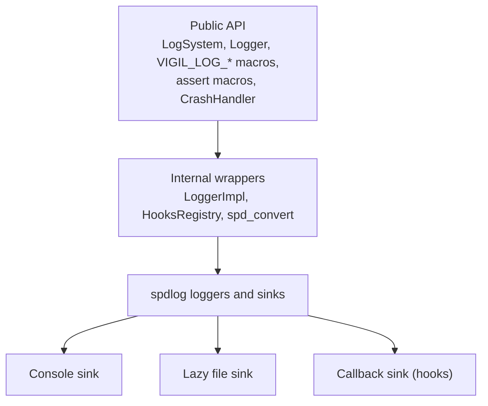
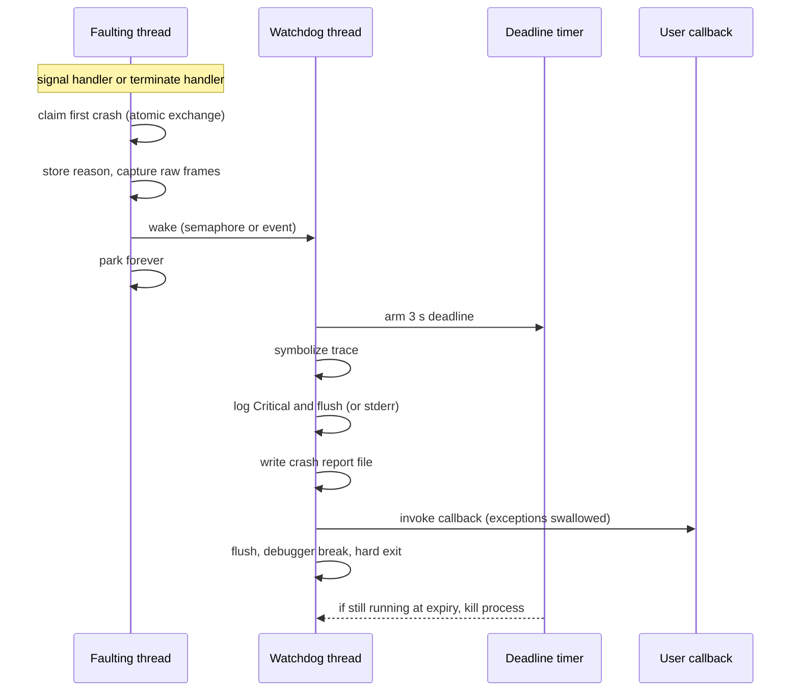

# Architecture

This document explains how Vigil is put together and why. It is aimed at contributors and anyone who wants to understand the internals. For how to _use_ Vigil, read the [User guide](user-guide.md).

- [Architecture](#architecture)
  - [Goals](#goals)
  - [Source layout](#source-layout)
  - [Layers](#layers)
  - [Logging internals](#logging-internals)
    - [Registry state](#registry-state)
    - [Initialization](#initialization)
    - [Sinks](#sinks)
    - [Names and spdlog](#names-and-spdlog)
    - [Async](#async)
  - [Threading model](#threading-model)
  - [Assertions internals](#assertions-internals)
  - [Stack trace internals](#stack-trace-internals)
  - [Crash pipeline](#crash-pipeline)
  - [Build system](#build-system)
    - [Flow](#flow)
    - [The `vigil` target (`src/CMakeLists.txt`)](#the-vigil-target-srccmakeliststxt)
    - [libbacktrace](#libbacktrace)
    - [Packaging](#packaging)
    - [Tests](#tests)
  - [Public and internal headers](#public-and-internal-headers)
  - [Deliberate design decisions](#deliberate-design-decisions)
    - [Logging](#logging)
    - [Crash handling](#crash-handling)
    - [Assertions](#assertions)
    - [Stack traces](#stack-traces)
    - [Build](#build)
  - [Recipes](#recipes)
    - [Add a source file](#add-a-source-file)
    - [Add a public header](#add-a-public-header)
    - [Add a dependency](#add-a-dependency)
    - [Add a crash trigger](#add-a-crash-trigger)
    - [Add an example](#add-an-example)
    - [Add a platform backend](#add-a-platform-backend)

## Goals

- A small, dependable diagnostics library: logging, assertions, stack traces, and crash handling.
- A stable public surface that does not leak implementation dependencies. `spdlog` never appears in a public header.
- Identical behavior on Windows, Linux, and macOS, with platform differences hidden behind `VIGIL_*` macros and private backends.
- Failure paths (assertions, crashes) that stay reliable even when the process is in a bad state.

## Source layout

```text
include/vigil/            Public headers. vigil.h is the umbrella.
  core/                   console, smart pointers, source location
  logging/                logger, log_system, log_level, hooks, limiter, scoped logger
  detail/                 compiler, platform, and export helpers (installed, internal)
  assert.h, crash_guard.h
src/                      Implementation and private headers. Never installed.
  core/                   console.cpp
  logging/                log_system.cpp, logger.cpp, log_limiter.cpp
  logging/detail/         logger_impl, hooks_registry, callback_sink, lazy_file_sink, spd_convert
  trace/                  stack_trace.{h,cpp}
  trace/detail/           stack_trace_backend.h, stack_trace_posix.cpp, stack_trace_win.cpp
  detail/                 symbol_utils.cpp
  assert.cpp, crash_guard.cpp
cmake/                    helpers/ (build_helpers.cmake), vendor/ (libbacktrace), templates/
vendor/                   fmt, spdlog, libbacktrace (do not edit)
tests/                    unit/, crash/, cmake_* consumer tests
examples/                 One executable per example
VERSION                   The only place the version is edited
```

## Layers



- The public layer exposes `LogSystem`, `Logger`, the macros, `CrashHandler`, and a few utilities. `Logger` is a thin handle holding a `Shared<detail::LoggerImpl>`.
- `LoggerImpl` wraps one `spdlog::logger` plus its sinks. It lives in `src/` and is the only place that includes `spdlog` directly. `spd_convert.h` translates between `LogLevel` and spdlog's levels.
- `fmt` is the single exception to the "no third-party types in public headers" rule: format strings (`fmt::format_string`) are part of the public API, which is why `fmt` is a public dependency and why installs require a system copy.

## Logging internals

### Registry state

`log_system.cpp` keeps all state in file-level globals guarded by one `std::recursive_mutex` (`g_Mutex`): the initialized flag, the main logger, a `name -> Logger` map, the shared console and file sinks, the global log directory, the async flags, and a `HooksRegistry`.

### Initialization

`LogSystem::Init()` builds, in order: the asynchronous thread pool (only if requested), the console sink, the lazy file sink, the main `LoggerImpl`, and finally registers the logger with spdlog and makes it spdlog's default. Any exception resets the partially built state and leaves the system uninitialized.

### Sinks

- **Console:** colored stdout sink with the pattern `%^[%T] [%n] %v%$`.
- **File:** a `LazyFileSink` wrapping either a rotating file sink (append mode, 10 MiB, 5 files) or a truncating basic file sink. The real sink is created on the first message that reaches it. If creation throws, the failure is reported once to `stderr`, further messages to that sink are dropped, and other sinks keep working.
- **Callback:** `CallbackSink` forwards `msg.payload` to `OnMessage` as an owned `LogMessageEvent`. It is created lazily when an `OnMessage` hook is registered and attached to every logger.

`Create(name)` reuses the shared console and file sinks. `Create(LogConfig)` builds a dedicated file sink when a file name, a directory (explicit or inherited), or a file level is in effect.

### Names and spdlog

Every logger is registered with spdlog under its name. `Remove()` and `SetMain()` also call `spdlog::drop(name)`, otherwise that name could never be created again.

### Async

spdlog has exactly one thread pool, created lazily (`EnsureAsyncThreadPool`) the first time any logger resolves to asynchronous. Async loggers use the `overrun_oldest` overflow policy. `Shutdown()` calls `spdlog::shutdown()`, whose pool teardown drains queued messages.

## Threading model

| Concern                                  | Mechanism                                                                                                                                       |
| :--------------------------------------- | :---------------------------------------------------------------------------------------------------------------------------------------------- |
| Registry                                 | `g_Mutex` (recursive). Every public `LogSystem` function locks it.                                                                              |
| Logging                                  | spdlog loggers are thread-safe; Vigil's sinks use `_mt` mutexes.                                                                                |
| `OnLevelChange`, `OnFlush`, `OnShutdown` | Copied while the lock is held, invoked **after** it is released. Callbacks may re-enter `LogSystem`.                                            |
| `OnMessage`                              | Invoked on the logging thread inside the callback sink's own mutex. It must stay fast and must not call `LogSystem`.                            |
| `Shutdown()`                             | Two phases: read the shutdown hook under the lock, call it unlocked, then lock again and tear down. A second check guards concurrent shutdowns. |
| Rate limiters                            | One function-local `static` container and mutex per policy.                                                                                     |

String views handed to callbacks (`LoggerName`) point at storage that dies with the lock scope, so the registry copies names into local `std::string`s before releasing the lock.

## Assertions internals

`assert.h` has two macro paths:

- **C++20:** `__VA_OPT__` detects whether a message was supplied, and `[[unlikely]]` is attached to the `if`.
- **C++17:** two macros, one with a message and one without, so `fmt::format()` is never called with an empty pack (ill-formed in some `fmt` versions). `VIGIL_UNLIKELY` uses `__builtin_expect`.

Change both paths or neither, and build under both standards.

`ReportAssertFailure` is defined out of line in `assert.cpp` to keep call sites small, break a header cycle with the logger, and let `[[noreturn]]` propagate. It captures and formats a trace, logs at `Critical` (or writes to `stderr` if logging is down), flushes, breaks into a debugger if attached, and calls `std::abort()`. On Windows it suppresses the CRT abort dialog.

`VIGIL_VERIFY` is defined independently of `VIGIL_ASSERT` so that `VIGIL_STRINGIFY` captures the expression without an extra layer of parentheses.

## Stack trace internals

`StackTrace` (private header `src/trace/stack_trace.h`) is the shared layer: it owns formatting, symbol simplification, and runtime-frame trimming. It delegates capture and resolution to a platform backend that exposes two functions declared in `stack_trace_backend.h`:

- `CaptureFrames(skip, max)`: capture and resolve the current stack.
- `ResolveAddresses(addresses, count)`: resolve raw addresses captured earlier (used by the crash pipeline).

The `.cpp` is chosen by CMake: `stack_trace_win.cpp` (DbgHelp, inline frames via `SymAddrIncludeInlineTrace`) or `stack_trace_posix.cpp` (`backtrace()` plus libbacktrace, with `backtrace_symbols()` as a fallback when libbacktrace cannot initialize). With `VIGIL_ENABLE_STACK_TRACE` off the backend is not compiled and the API returns empty results.

Resolution is serialized by a mutex because neither DbgHelp nor libbacktrace (configured with `threaded=0`) is thread-safe. On POSIX, libbacktrace reports inlined call sites first and the physical frame last, so every frame but the last for a given address is marked inlined. Vigil mirrors that ordering on Windows.

## Crash pipeline



The design splits work by safety:

- **Faulting thread** (`SignalCrash`): async-signal-safe only. No allocation, no locks, no logging, no `std::string`. It stores a `const char*` reason and up to 64 raw return addresses in a leaked global, signals a semaphore (POSIX) or event (Windows), and parks.
- **Watchdog thread** (started during `Install()`): does everything that is unsafe in a handler. Each step is bounded and exception-safe, and the order is deliberate: logging first (most reliable), the report file next, and user code last (least trusted).
- **Deadline**: `ArmDeadline` starts a `SIGALRM` alarm (POSIX) or a time-critical thread (Windows) that terminates the process if the report pipeline hangs.

Platform specifics:

- POSIX installs `sigaction` handlers with `SA_ONSTACK` for `SIGSEGV`, `SIGABRT`, `SIGFPE`, `SIGILL`, and `SIGBUS`. Each thread has a 64 KiB `thread_local` alternate stack installed by `InstallThreadAltStack`. `Install()` primes `backtrace()` once so its lazy library load never happens inside a handler.
- Windows installs an unhandled-exception filter, `_set_purecall_handler`, `_set_invalid_parameter_handler`, a `new` handler, and a `SIGABRT` handler. Every path parks the thread instead of returning `EXCEPTION_EXECUTE_HANDLER`, which would let the OS kill the process before the watchdog finishes. Stack overflow skips frame capture. Each thread reserves a 64 KiB stack guarantee.
- `std::terminate` is handled on all platforms by `OnTerminate`, which rethrows the current exception to extract its message.

Rules for changing this code:

- Everything reachable from `SignalCrash` and the signal handlers must stay async-signal-safe.
- Every new step in `Report()` must be bounded and exception-safe.
- Threads created by the application call `InstallThreadAltStack()`. Do the same in examples and tests that spawn threads.

## Build system

### Flow

1. `CMakeLists.txt` adds `cmake/` and `cmake/vendor/` to the module path and includes `cmake/helpers/build_helpers.cmake`.
2. `vigil_load_version()` reads `VERSION` **before** `project()`, validates it against `X.Y.Z` or `X.Y.Z-WIP`, and sets `VIGIL_IS_PRERELEASE` for `-WIP`.
3. Options are declared and validated. `vigil_option_debug_default()` gives `VIGIL_ENABLE_ASSERTS` and `VIGIL_ENABLE_SCOPED_LOG` an `ON` default for Debug and RelWithDebInfo, unless the cache already holds a value.
4. `version.h` is generated from `include/vigil/version.h.in`.
5. `vendor/`, then `src/`, then optionally `examples/` and `tests/` are added.

### The `vigil` target (`src/CMakeLists.txt`)

- Sources are listed explicitly in `VIGIL_SOURCES`. A new `.cpp` must be added there.
- Public headers are a `PUBLIC FILE_SET HEADERS`, which drives installation. Internal headers are a `PRIVATE` file set and are installed separately into `include/vigil/detail` because public headers include them.
- The library is static or shared according to `VIGIL_BUILD_SHARED`. On GCC and Clang it uses hidden visibility by default, and `VIGIL_API` exports the public symbols.
- Compile definitions: `VIGIL_ENABLE_STACK_TRACE`, `VIGIL_ENABLE_SCOPED_LOG`, `VIGIL_ENABLE_ASSERTS`, and `VIGIL_SHARED_LIBRARY` are `PUBLIC` (consumers see the same configuration). `VIGIL_EXPORT_SYMBOLS` and the debug/release markers are `PRIVATE`.
- Dependencies: `fmt::fmt` is `PUBLIC`; `spdlog::spdlog` and `Threads::Threads` are `PRIVATE`. On Windows `dbghelp` is linked privately; on POSIX `vigil::libbacktrace` is.
- `/Zc:preprocessor` is an `INTERFACE` option for MSVC so consumers get a conformant preprocessor for Vigil's variadic macros.
- The helpers `vigil_configure_compiler`, `vigil_configure_warnings`, `vigil_enable_coverage`, and `vigil_strip_dead_code` apply per-target settings.

### libbacktrace

`cmake/vendor/libbacktrace.cmake` builds the vendored sources with `ExternalProject_Add` (`configure`, `make`, `make install`) into `build/_deps/libbacktrace` and exposes the result as the imported static target `vigil::libbacktrace`. For installs, the archive is copied to the library directory and `VigilConfig.cmake.in` recreates the imported target for consumers.

### Packaging

With `VIGIL_INSTALL=ON`, the install rules export `vigil::vigil` (`vigil-targets.cmake`), generate `VigilConfig.cmake` and a `SameMajorVersion` version file, render `Vigil.pc`, and install the README, LICENSE, and `docs/` directory. `VigilConfig.cmake.in` is where consumer-side dependencies (`fmt`, `Threads`, `libbacktrace`) are declared.

### Tests

See [Development](development.md#testing). Unit tests are discovered automatically; crash and consumer suites run real CMake builds through `ctest --build-and-test`.

## Public and internal headers

| Location                                 | Installed | Audience     | Notes                                                                       |
| :--------------------------------------- | :-------: | :----------- | :-------------------------------------------------------------------------- |
| `include/vigil/*.h`, `core/`, `logging/` |    yes    | Consumers    | Public API. Mark exported symbols `VIGIL_API`.                              |
| `include/vigil/detail/`                  |    yes    | Library only | Installed only because public headers include them. No stability guarantee. |
| `src/`                                   |    no     | Library only | Private headers. May include `spdlog`.                                      |
| `build/include/vigil/version.h`          |    yes    | Consumers    | Generated from `version.h.in`.                                              |

Rules:

- A new public header goes into `VIGIL_HEADERS`, into `vigil.h` if it belongs in the umbrella, and must be installed.
- Platform and compiler checks use `VIGIL_PLATFORM_*`, `VIGIL_COMPILER_*`, and the wrappers in `compiler_attributes.h`, never raw `_WIN32`, `__linux__`, or compiler attributes.
- Public names live in `vigil`; internals live in `vigil::detail` or an anonymous namespace.
- `Scope<T>` is the default ownership alias; use `Shared<T>` only when ownership is shared.

## Deliberate design decisions

Each of these looks wrong at first glance and has a reason. Please read it before "fixing" anything.

### Logging

- **`g_Mutex` is recursive.** The crash handler can re-enter logging on the same thread while a previous logging call still holds the lock. A plain mutex would deadlock.
- **Callbacks run outside the lock** (`OnLevelChange`, `OnFlush`, `OnShutdown`). The pattern is: copy the callback while locked, unlock, then call it. Reentrant calls must not trigger the same hook recursively. `OnMessage` is the exception and runs inside the sink lock, which is why it must never call back into `LogSystem`. It may call `Logger::SetLevel`, but that change is applied silently to avoid taking the registry lock or dispatching another callback under the sink lock.
- Level updates, including silent updates from `OnMessage`, use a separate non-recursive level mutex to serialize the old-level read and update. The lock order is registry mutex followed by level mutex; code holding the level mutex must not acquire any other lock. Non-silent updates hold the registry lock during the update, preventing `Shutdown()` from tearing down the logger mid-update. `OnLevelChange` callbacks run unlocked, may execute concurrently, and are not guaranteed to run in change order.
- **Uninitialized use never throws from free functions and macros.** They assert in debug builds and print one warning in release. `Create`, `Main`, and `Get` do throw `std::logic_error` because they must return a reference.
- **Removing or replacing a logger also drops its name in spdlog.** Otherwise the name cannot be reused.
- **File sinks are lazy and thread-safe.** A missing file never aborts logging, and unused loggers never leave empty `.log` files.
- **`LevelChangeEvent` and `FlushEvent` hold `string_view`s.** Names are copied into locals while the lock is held so the view stays valid when the callback runs afterwards.

### Crash handling

- **Everything reachable from a handler is async-signal-safe**, so there is no allocation, locking, logging, or `std::string`. Symbolization happens later on the watchdog thread because `StackTrace::Capture` and `Format` are not signal-safe.
- **`g_State` is leaked on purpose** so a crash during static destruction still finds it alive.
- **The report order is deliberate**: log, then report file, then user callback. The deadline kills the process if any step hangs.
- **Only the first crash is reported.** Later crashing threads park, and the deadline covers a crash inside the watchdog itself.

### Assertions

- **`VIGIL_ASSERT*` does not evaluate its condition when assertions are off.** Anything with side effects belongs in `VIGIL_VERIFY*`.
- **Two macro implementations** (C++17 and C++20) exist to avoid empty `fmt::format()` calls on C++17.

### Stack traces

- **With `VIGIL_ENABLE_STACK_TRACE` off the API still compiles** and returns empty results, so call sites need no `#if`.
- **Resolution is serialized** because neither libbacktrace (as configured) nor DbgHelp is thread-safe.

### Build

- **`vigil_load_version()` runs before `project()`** because `project(VERSION ...)` needs the value.
- **Debug-dependent defaults are decided at configure time**, which is why multi-config generators apply them to every configuration.
- **Windows crash/consumer tests need an explicit build type**: the harness forwards `CMAKE_BUILD_TYPE` to `ctest --build-and-test`, and multi-config generators leave it empty.

## Recipes

### Add a source file

Add it to `VIGIL_SOURCES` in `src/CMakeLists.txt`. Private headers need nothing else.

### Add a public header

1. Put it in `include/vigil/<area>/`.
2. Add it to `VIGIL_HEADERS` in `src/CMakeLists.txt` (and mark exported symbols with `VIGIL_API`).
3. Include it from `vigil.h` if it belongs in the umbrella.
4. Update the public API documentation and, if the signature of anything existing changed, the README and `examples/`.

### Add a dependency

Ask first: Vigil avoids new dependencies. If one is approved, add it under `vendor/` or as a find-able package, link it `PRIVATE` unless it appears in public headers, and for a public dependency add an entry to both `VigilConfig.cmake.in` and `Vigil.pc.in`.

### Add a crash trigger

Add a header under `tests/crash/project/triggers/`, a branch in `tests/crash/project/main.cpp`, and the name to `VIGIL_CRASH_TRIGGERS` in `tests/crash/CMakeLists.txt`. These tests are expected to die (`WILL_FAIL`).

### Add an example

Create the source under `examples/<category>/` and register it in `examples/CMakeLists.txt` with `vigil_add_example`.

### Add a platform backend

Implement `CaptureFrames` and `ResolveAddresses` from `stack_trace_backend.h`, select the file in `src/CMakeLists.txt`, extend `platform_detection.h` and `symbol_export.h`, and add the platform to CI.
